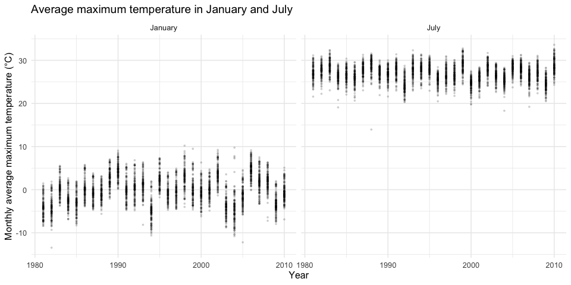
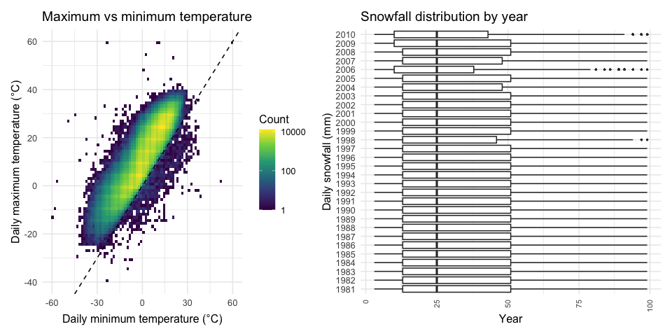
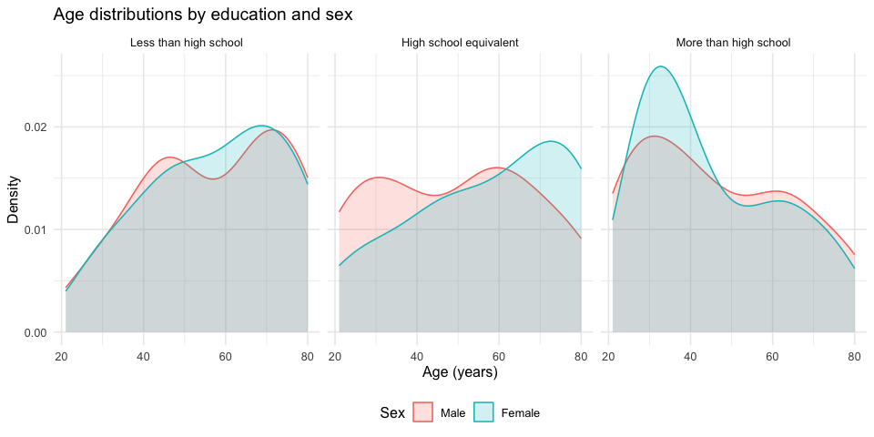
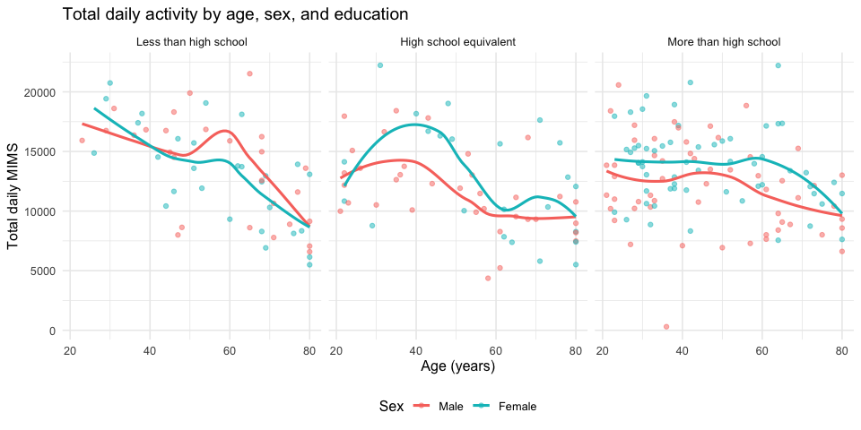
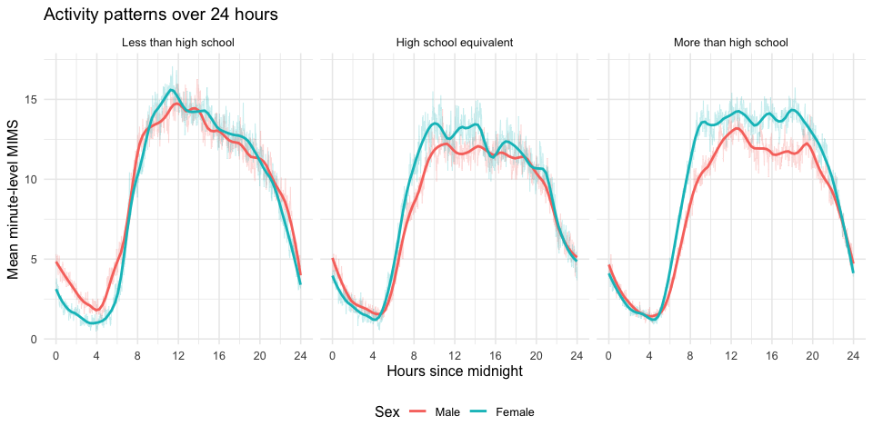
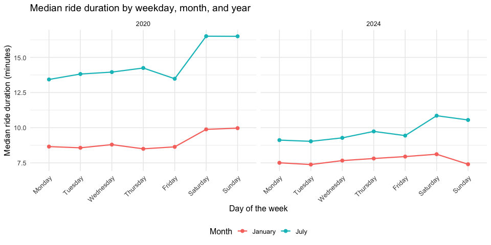
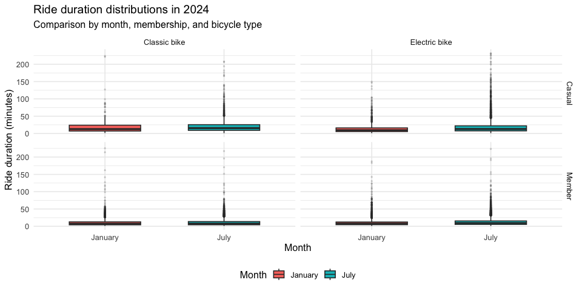

p8105_hw3_ym3197
================
Yichaun Ma
2026-10-19

\#problem 1

\#Set global figure dimensions, font size, and code chunk options.

``` r
knitr::opts_chunk$set(
  echo = TRUE,
  message = FALSE,
  fig.width = 10,
  fig.height = 5
)

library(tidyverse)
```

    ## ── Attaching core tidyverse packages ──────────────────────── tidyverse 2.0.0 ──
    ## ✔ dplyr     1.2.1     ✔ readr     2.2.0
    ## ✔ forcats   1.0.1     ✔ stringr   1.6.0
    ## ✔ ggplot2   4.0.3     ✔ tibble    3.3.1
    ## ✔ lubridate 1.9.5     ✔ tidyr     1.3.2
    ## ✔ purrr     1.2.2     
    ## ── Conflicts ────────────────────────────────────────── tidyverse_conflicts() ──
    ## ✖ dplyr::filter() masks stats::filter()
    ## ✖ dplyr::lag()    masks stats::lag()
    ## ℹ Use the conflicted package (<http://conflicted.r-lib.org/>) to force all conflicts to become errors

``` r
library(p8105.datasets)
library(patchwork)

theme_set(
  theme_minimal(base_size = 12)
)
```

# Load ny_noaa

``` r
data("ny_noaa")
```

``` r
glimpse(ny_noaa)
```

    ## Rows: 2,595,176
    ## Columns: 7
    ## $ id   <chr> "US1NYAB0001", "US1NYAB0001", "US1NYAB0001", "US1NYAB0001", "US1N…
    ## $ date <date> 2007-11-01, 2007-11-02, 2007-11-03, 2007-11-04, 2007-11-05, 2007…
    ## $ prcp <int> NA, NA, NA, NA, NA, NA, NA, NA, NA, NA, NA, NA, NA, NA, NA, NA, 3…
    ## $ snow <int> NA, NA, NA, NA, NA, NA, NA, NA, NA, NA, NA, NA, NA, NA, NA, NA, 3…
    ## $ snwd <int> NA, NA, NA, NA, NA, NA, NA, NA, NA, NA, NA, NA, NA, NA, NA, NA, 0…
    ## $ tmax <chr> NA, NA, NA, NA, NA, NA, NA, NA, NA, NA, NA, NA, NA, NA, NA, NA, N…
    ## $ tmin <chr> NA, NA, NA, NA, NA, NA, NA, NA, NA, NA, NA, NA, NA, NA, NA, NA, N…

``` r
noaa_summary =
  ny_noaa |>
  summarize(
    n_observations = n(),
    n_variables = ncol(ny_noaa),
    n_stations = n_distinct(id),
    first_date = min(date, na.rm = TRUE),
    last_date = max(date, na.rm = TRUE)
  )

noaa_summary
```

    ## # A tibble: 1 × 5
    ##   n_observations n_variables n_stations first_date last_date 
    ##            <int>       <int>      <int> <date>     <date>    
    ## 1        2595176           7        747 1981-01-01 2010-12-31

``` r
missing_summary =
  ny_noaa |>
  summarize(
    across(
      c(prcp, snow, snwd, tmax, tmin),
      list(
        n_missing = ~sum(is.na(.x)),
        pct_missing = ~mean(is.na(.x)) * 100
      ),
      .names = "{.col}_{.fn}"
    )
  ) |>
  pivot_longer(
    cols = everything(),
    names_to = c("variable", ".value"),
    names_pattern = "^(.*)_(n_missing|pct_missing)$"
  ) |>
  mutate(
    pct_missing = round(pct_missing, 2)
  )

knitr::kable(
  missing_summary,
  col.names = c(
    "Variable",
    "Missing observations",
    "Missing (%)"
  )
)
```

| Variable | Missing observations | Missing (%) |
|:---------|---------------------:|------------:|
| prcp     |               145838 |        5.62 |
| snow     |               381221 |       14.69 |
| snwd     |               591786 |       22.80 |
| tmax     |              1134358 |       43.71 |
| tmin     |              1134420 |       43.71 |

# data cleanning

``` r
noaa_clean =
  ny_noaa |>
  separate(
    date,
    into = c("year", "month", "day"),
    sep = "-",
    convert = TRUE
  ) |>
  mutate(
    tmax = as.numeric(tmax) / 10,
    tmin = as.numeric(tmin) / 10,
    prcp = prcp / 10
  )
```

# Exclude missing snowfall values, sort snowfall amounts by frequency, and display the 10 most common values.

``` r
snow_counts =
  noaa_clean |>
  filter(!is.na(snow)) |>
  count(snow, sort = TRUE)

knitr::kable(
  snow_counts |>
    slice_head(n = 10),
  col.names = c("Snowfall (mm)", "Number of observations")
)
```

| Snowfall (mm) | Number of observations |
|--------------:|-----------------------:|
|             0 |                2008508 |
|            25 |                  31022 |
|            13 |                  23095 |
|            51 |                  18274 |
|            76 |                  10173 |
|             8 |                   9962 |
|             5 |                   9748 |
|            38 |                   9197 |
|             3 |                   8790 |
|           102 |                   6552 |

# Use records with nonmissing snowfall as the denominator.

``` r
snow_summary =
  noaa_clean |>
  summarize(
    n_observed = sum(!is.na(snow)),
    n_zero = sum(snow == 0, na.rm = TRUE),
    pct_zero = mean(snow == 0, na.rm = TRUE) * 100
  )

snow_summary
```

    ## # A tibble: 1 × 3
    ##   n_observed  n_zero pct_zero
    ##        <int>   <int>    <dbl>
    ## 1    2213955 2008508     90.7

# Average maximum temperature in January and July

``` r
monthly_tmax =
  noaa_clean |>
  filter(month %in% c(1, 7)) |>
  group_by(id, year, month) |>
  summarize(
    n_days = sum(!is.na(tmax)),
    mean_tmax = mean(tmax, na.rm = TRUE),
    .groups = "drop"
  ) |>
  filter(n_days > 0) |>
  mutate(
    month = factor(
      month,
      levels = c(1, 7),
      labels = c("January", "July")
    )
  )
```

# Each point represents a station’s average maximum temperature in January or July of a particular year. Both panels use the same y-axis scale for comparison.

``` r
monthly_tmax_plot =
  monthly_tmax |>
  ggplot(aes(x = year, y = mean_tmax)) +
  geom_point(
    alpha = 0.15,
    size = 0.6
  ) +
  facet_wrap(~month, nrow = 1) +
  labs(
    title = "Average maximum temperature in January and July",
    x = "Year",
    y = "Monthly average maximum temperature (°C)"
  )

monthly_tmax_plot
```

<!-- -->

# List the five lowest monthly averages for January and July separately, together with station IDs, years, observation counts.

``` r
lowest_tmax =
  monthly_tmax |>
  group_by(month) |>
  slice_min(
    order_by = mean_tmax,
    n = 5,
    with_ties = FALSE
  ) |>
  ungroup()

knitr::kable(lowest_tmax, digits = 2)
```

| id          | year | month   | n_days | mean_tmax |
|:------------|-----:|:--------|-------:|----------:|
| USC00301723 | 1982 | January |     31 |    -13.44 |
| USC00305925 | 2005 | January |      1 |    -12.20 |
| USC00306957 | 2004 | January |     31 |    -10.79 |
| USC00304996 | 1994 | January |     31 |    -10.62 |
| USW00094725 | 2004 | January |     31 |    -10.41 |
| USC00308962 | 1988 | July    |     31 |     13.95 |
| USC00302454 | 2004 | July    |     31 |     18.30 |
| USC00308946 | 1984 | July    |     31 |     19.08 |
| USC00309389 | 2007 | July    |     31 |     19.22 |
| USC00306957 | 2000 | July    |     31 |     19.76 |

# List the five highest monthly averages for January and July separately. Interpret extreme averages alongside their observation counts.

``` r
highest_tmax =
  monthly_tmax |>
  group_by(month) |>
  slice_max(
    order_by = mean_tmax,
    n = 5,
    with_ties = FALSE
  ) |>
  ungroup()

knitr::kable(highest_tmax, digits = 2)
```

| id          | year | month   | n_days | mean_tmax |
|:------------|-----:|:--------|-------:|----------:|
| USC00303464 | 1998 | January |     13 |     10.22 |
| USR0000NSTO | 2004 | January |      2 |      9.75 |
| USC00307633 | 1999 | January |     21 |      9.49 |
| USC00307633 | 2002 | January |     30 |      9.24 |
| USW00014732 | 2006 | January |     31 |      9.14 |
| USC00305377 | 2010 | July    |     31 |     33.60 |
| USC00309292 | 1999 | July    |     31 |     32.77 |
| USC00308946 | 2010 | July    |     31 |     32.66 |
| USW00014732 | 2010 | July    |     31 |     32.57 |
| USC00304025 | 1999 | July    |     17 |     32.52 |

# include all months and retain records with both maximum and minimum temperatures observed.

``` r
temp_data =
  noaa_clean |>
  filter(
    !is.na(tmin),
    !is.na(tmax)
  )
```

# Use a two-dimensional binned plot to address overplotting. The dashed line represents equal maximum and minimum temperatures. Records below it have maximum temperatures lower than minimum temperatures and warrant investigation.

``` r
temp_plot =
  temp_data |>
  ggplot(aes(x = tmin, y = tmax)) +
  geom_bin2d(bins = 80) +
  geom_abline(
    intercept = 0,
    slope = 1,
    linetype = "dashed"
  ) +
  scale_fill_viridis_c(trans = "log10") +
  labs(
    title = "Maximum vs minimum temperature",
    x = "Daily minimum temperature (°C)",
    y = "Daily maximum temperature (°C)",
    fill = "Count"
  )
```

# Calculate the correlation between observed temperatures and count records where maximum temperature is below minimum temperature to support interpretation.

``` r
temp_summary =
  temp_data |>
  summarize(
    n_pairs = n(),
    correlation = cor(tmin, tmax),
    n_tmax_below_tmin = sum(tmax < tmin)
  )

temp_summary
```

    ## # A tibble: 1 × 3
    ##   n_pairs correlation n_tmax_below_tmin
    ##     <int>       <dbl>             <int>
    ## 1 1458900       0.905              1183

``` r
snow_data =
  noaa_clean |>
  filter(
    snow > 0,
    snow < 100
  )
```

# Create one boxplot per year to compare the medians, interquartile ranges, and distributions of the selected snowfall amounts.

``` r
snow_plot =
  snow_data |>
  ggplot(aes(x = snow, y = factor(year))) +
  geom_boxplot(outlier.size = 0.4) +
  labs(
    title = "Snowfall distribution by year",
    x = "Year",
    y = "Daily snowfall (mm)"
  ) +
  theme(
    axis.text.x = element_text(
      angle = 90,
      hjust = 1,
      vjust = 0.5,
      size = 8
    )
  )
```

# Display the plots side by side, giving the snowfall panel more width to improve the readability of year labels.

``` r
temp_snow_plot =
  temp_plot + snow_plot +
  plot_layout(widths = c(1, 1.5))

temp_snow_plot
```

<!-- -->

# Calculate yearly observation counts, medians, and quartiles to support interpretation of the boxplots.

``` r
snow_year_summary =
  snow_data |>
  group_by(year) |>
  summarize(
    n_records = n(),
    median_snow = median(snow),
    q1_snow = quantile(snow, 0.25),
    q3_snow = quantile(snow, 0.75),
    .groups = "drop"
  )

knitr::kable(snow_year_summary, digits = 2)
```

| year | n_records | median_snow | q1_snow | q3_snow |
|-----:|----------:|------------:|--------:|--------:|
| 1981 |      5961 |          25 |      13 |      51 |
| 1982 |      5991 |          25 |      13 |      51 |
| 1983 |      4785 |          25 |      13 |      51 |
| 1984 |      5373 |          25 |      13 |      51 |
| 1985 |      6887 |          25 |      13 |      51 |
| 1986 |      5400 |          25 |      13 |      51 |
| 1987 |      4780 |          25 |      13 |      51 |
| 1988 |      5077 |          25 |      13 |      51 |
| 1989 |      6086 |          25 |      13 |      51 |
| 1990 |      4570 |          25 |      13 |      51 |
| 1991 |      5149 |          25 |      13 |      51 |
| 1992 |      5488 |          25 |      13 |      51 |
| 1993 |      5494 |          25 |      13 |      51 |
| 1994 |      5277 |          25 |      13 |      51 |
| 1995 |      5659 |          25 |      13 |      51 |
| 1996 |      5687 |          25 |      13 |      51 |
| 1997 |      5639 |          25 |      13 |      51 |
| 1998 |      3071 |          25 |      13 |      46 |
| 1999 |      3917 |          25 |      13 |      51 |
| 2000 |      4794 |          25 |      13 |      51 |
| 2001 |      4461 |          25 |      13 |      51 |
| 2002 |      4977 |          25 |      13 |      51 |
| 2003 |      5098 |          25 |      13 |      51 |
| 2004 |      5612 |          25 |      13 |      48 |
| 2005 |      6203 |          25 |      13 |      51 |
| 2006 |      4604 |          25 |      10 |      38 |
| 2007 |      6946 |          25 |      13 |      48 |
| 2008 |      9260 |          25 |      13 |      51 |
| 2009 |      8735 |          25 |      10 |      51 |
| 2010 |     11590 |          25 |      10 |      43 |

# problem 2

# Data import and cleaning

``` r
covar_raw =
  read_csv(
    "data/nhanes_covar.csv",
    skip = 4,
    na = c("", "NA", ".")
  ) |>
  rename_with(tolower)
```

# Each row represents one participant, with min1 through min1440 recording minute-level MIMS activity starting at midnight

``` r
accel_raw =
  read_csv(
    "data/nhanes_accel.csv"
  ) |>
  rename_with(tolower)
```

# Exclude participants with missing demographic information and those younger than 21

``` r
covar_clean =
  covar_raw |>
  drop_na() |>
  filter(age >= 21) |>
  mutate(
    sex = factor(
      sex,
      levels = c(1, 2),
      labels = c("Male", "Female")
    ),
    education = factor(
      education,
      levels = c(1, 2, 3),
      labels = c(
        "Less than high school",
        "High school equivalent",
        "More than high school"
      )
    )
  )
```

# Merge the datasets by participant ID, seqn. The result contains one row per participant, retaining all demographic and minute-level activity variables

``` r
nhanes_wide =
  covar_clean |>
  inner_join(
    accel_raw,
    by = "seqn"
  )

nhanes_wide |>
  summarize(
    n_participants = n_distinct(seqn),
    n_variables = ncol(nhanes_wide)
  )
```

    ## # A tibble: 1 × 2
    ##   n_participants n_variables
    ##            <int>       <int>
    ## 1            228        1445

# Reshape the minute columns into minute and mims

``` r
nhanes_long =
  nhanes_wide |>
  pivot_longer(
    cols = starts_with("min"),
    names_to = "minute",
    names_prefix = "min",
    values_to = "mims"
  ) |>
  mutate(
    minute = as.integer(minute),
    hour = (minute - 1) / 60
  )
```

# Count participants using the one-row-per-participant dataset to avoid counting each person repeatedly

``` r
participant_table =
  nhanes_wide |>
  count(
    education,
    sex,
    name = "n"
  ) |>
  pivot_wider(
    names_from = sex,
    values_from = n,
    values_fill = 0
  )

knitr::kable(
  participant_table,
  col.names = c(
    "Education level",
    "Male",
    "Female"
  ),
  caption = "Number of participants by education and sex"
)
```

| Education level        | Male | Female |
|:-----------------------|-----:|-------:|
| Less than high school  |   27 |     28 |
| High school equivalent |   35 |     23 |
| More than high school  |   56 |     59 |

Number of participants by education and sex

# Use separate panels for education levels and colors for sex. Density curves compare the shapes of age distributions

``` r
age_plot =
  nhanes_wide |>
  ggplot(
    aes(
      x = age,
      color = sex,
      fill = sex
    )
  ) +
  geom_density(alpha = 0.2) +
  facet_wrap(~education, nrow = 1) +
  labs(
    title = "Age distributions by education and sex",
    x = "Age (years)",
    y = "Density",
    color = "Sex",
    fill = "Sex"
  ) +
  theme_minimal(base_size = 12) +
  theme(
    legend.position = "bottom"
  )

age_plot
```

<!-- -->

# median ages by education and sex to support the age comparisons

``` r
age_summary =
  nhanes_wide |>
  group_by(
    education,
    sex
  ) |>
  summarize(
    n = n(),
    median_age = median(age),
    .groups = "drop"
  )

knitr::kable(
  age_summary,
  digits = 1,
  col.names = c(
    "Education level",
    "Sex",
    "Participants",
    "Median age"
  )
)
```

| Education level        | Sex    | Participants | Median age |
|:-----------------------|:-------|-------------:|-----------:|
| Less than high school  | Male   |           27 |       60.0 |
| Less than high school  | Female |           28 |       61.0 |
| High school equivalent | Male   |           35 |       53.0 |
| High school equivalent | Female |           23 |       62.0 |
| More than high school  | Male   |           56 |       43.5 |
| More than high school  | Female |           59 |       41.0 |

# Sum each participant’s 1,440 minute-level MIMS values

``` r
total_activity =
  nhanes_long |>
  group_by(
    seqn,
    sex,
    age,
    bmi,
    education
  ) |>
  summarize(
    total_mims = sum(mims),
    .groups = "drop"
  )
```

# Plot total daily activity against age, with separate education panels and colors for sex. Add LOESS smooth curves to describe trends

``` r
total_activity_plot =
  total_activity |>
  ggplot(
    aes(
      x = age,
      y = total_mims,
      color = sex
    )
  ) +
  geom_point(
    alpha = 0.5,
    size = 1.5
  ) +
  geom_smooth(
    method = "loess",
    se = FALSE
  ) +
  facet_wrap(~education, nrow = 1) +
  labs(
    title = "Total daily activity by age, sex, and education",
    x = "Age (years)",
    y = "Total daily MIMS",
    color = "Sex"
  ) +
  theme_minimal(base_size = 12) +
  theme(
    legend.position = "bottom"
  )

total_activity_plot
```

<!-- -->

# Average activity across participants within each education, sex, and minute group to obtain six group-level daily activity profiles

``` r
activity_by_minute =
  nhanes_long |>
  group_by(
    education,
    sex,
    minute,
    hour
  ) |>
  summarize(
    mean_mims = mean(mims),
    .groups = "drop"
  )
```

# Use three education panels and colors for sex. Faint lines show minute-level group means, and thicker curves show smoothed trends. Shared scales allow comparisons across panels

``` r
daily_activity_plot =
  activity_by_minute |>
  ggplot(
    aes(
      x = hour,
      y = mean_mims,
      color = sex
    )
  ) +
  geom_line(
    alpha = 0.25,
    linewidth = 0.3
  ) +
  geom_smooth(
    method = "loess",
    span = 0.15,
    se = FALSE,
    linewidth = 1
  ) +
  facet_wrap(~education, nrow = 1) +
  scale_x_continuous(
    breaks = seq(0, 24, by = 4),
    limits = c(0, 24)
  ) +
  labs(
    title = "Activity patterns over 24 hours",
    x = "Hours since midnight",
    y = "Mean minute-level MIMS",
    color = "Sex"
  ) +
  theme_minimal(base_size = 12) +
  theme(
    legend.position = "bottom"
  )

daily_activity_plot
```

<!-- -->

# problem 3

# Import the CSV and add year and month variables

``` r
bike_2020_jan =
  read_csv(
    "data/Jan 2020 Citi.csv",
    na = c("", "NA")
  ) |>
  mutate(
    year = 2020,
    month = "January"
  )
```

# Import the July 2020 data and add time labels

``` r
bike_2020_july =
  read_csv(
    "data/July 2020 Citi.csv",
    na = c("", "NA")
  ) |>
  mutate(
    year = 2020,
    month = "July"
  )
```

# Import the January 2024 data and add time labels

``` r
bike_2024_jan =
  read_csv(
    "data/Jan 2024 Citi.csv",
    na = c("", "NA")
  ) |>
  mutate(
    year = 2024,
    month = "January"
  )
```

# Import the July 2024 data and add time labels

``` r
bike_2024_july =
  read_csv(
    "data/July 2024 Citi.csv",
    na = c("", "NA")
  ) |>
  mutate(
    year = 2024,
    month = "July"
  )
```

# Combine the files by rows, retain the original variables, and encode categorical variables with meaningful labels and ordering

``` r
citibike =
  bind_rows(
    bike_2020_jan,
    bike_2020_july,
    bike_2024_jan,
    bike_2024_july
  ) |>
  mutate(
    year = factor(
      year,
      levels = c(2020, 2024)
    ),
    month = factor(
      month,
      levels = c("January", "July")
    ),
    weekdays = factor(
      weekdays,
      levels = c(
        "Monday",
        "Tuesday",
        "Wednesday",
        "Thursday",
        "Friday",
        "Saturday",
        "Sunday"
      )
    ),
    member_casual = factor(
      member_casual,
      levels = c("casual", "member"),
      labels = c("Casual", "Member")
    ),
    rideable_type = factor(
      rideable_type,
      levels = c("classic_bike", "electric_bike"),
      labels = c("Classic bike", "Electric bike")
    )
  )
```

# Check dataset size and missing values. Retain rides with missing station names for duration analyses

``` r
citibike |>
  summarize(
    n_rides = n(),
    n_variables = ncol(citibike),
    n_unique_ride_ids = n_distinct(ride_id),
    missing_duration = sum(is.na(duration)),
    missing_start_station = sum(is.na(start_station_name)),
    missing_end_station = sum(is.na(end_station_name))
  )
```

    ## # A tibble: 1 × 6
    ##   n_rides n_variables n_unique_ride_ids missing_duration missing_start_station
    ##     <int>       <int>             <int>            <int>                 <int>
    ## 1   99485           9             99485                0                    43
    ## # ℹ 1 more variable: missing_end_station <int>

# Create one row per year–month combination, with separate columns for Casual and Member ride counts

``` r
ride_counts =
  citibike |>
  count(
    year,
    month,
    member_casual,
    name = "n_rides"
  ) |>
  pivot_wider(
    names_from = member_casual,
    values_from = n_rides,
    values_fill = 0
  ) |>
  arrange(year, month)

knitr::kable(
  ride_counts,
  col.names = c(
    "Year",
    "Month",
    "Casual rides",
    "Member rides"
  ),
  caption = "Sampled rides by year, month, and membership"
)
```

| Year | Month   | Casual rides | Member rides |
|:-----|:--------|-------------:|-------------:|
| 2020 | January |          984 |        11436 |
| 2020 | July    |         5637 |        15411 |
| 2024 | January |         2108 |        16753 |
| 2024 | July    |        10894 |        36262 |

Sampled rides by year, month, and membership

# Exclude missing starting-station names and rank stations by their sampled departure counts

``` r
top_stations =
  citibike |>
  filter(
    year == "2024",
    month == "July",
    !is.na(start_station_name)
  ) |>
  count(
    start_station_name,
    name = "n_rides"
  ) |>
  arrange(
    desc(n_rides),
    start_station_name
  ) |>
  slice_head(n = 5)

knitr::kable(
  top_stations,
  col.names = c(
    "Starting station",
    "Sampled departures"
  ),
  caption = "Five most popular starting stations in July 2024"
)
```

| Starting station         | Sampled departures |
|:-------------------------|-------------------:|
| Pier 61 at Chelsea Piers |                163 |
| University Pl & E 14 St  |                155 |
| W 21 St & 6 Ave          |                152 |
| West St & Chambers St    |                150 |
| W 31 St & 7 Ave          |                146 |

Five most popular starting stations in July 2024

# Calculate median ride duration by year, month, and weekday

``` r
median_duration =
  citibike |>
  group_by(
    year,
    month,
    weekdays
  ) |>
  summarize(
    median_duration = median(duration),
    .groups = "drop"
  )
```

\#m Plot weekday against median duration in minutes, using colors for
months and panels for years

``` r
median_duration_plot =
  median_duration |>
  ggplot(
    aes(
      x = weekdays,
      y = median_duration,
      color = month,
      group = month
    )
  ) +
  geom_line(linewidth = 0.8) +
  geom_point(size = 2) +
  facet_wrap(~year, nrow = 1) +
  labs(
    title = "Median ride duration by weekday, month, and year",
    x = "Day of the week",
    y = "Median ride duration (minutes)",
    color = "Month"
  ) +
  theme_minimal(base_size = 12) +
  theme(
    axis.text.x = element_text(
      angle = 45,
      hjust = 1
    ),
    legend.position = "bottom"
  )

median_duration_plot
```

<!-- -->

# Restrict the final analysis to 2024 and compare duration distributions by month, membership, and bicycle type.

``` r
bike_2024 =
  citibike |>
  filter(year == "2024")
```

# Use membership for panel rows, bicycle type for panel columns, and month on the x-axis. Share the y-axis scale across panels

``` r
duration_2024_plot =
  bike_2024 |>
  ggplot(
    aes(
      x = month,
      y = duration,
      fill = month
    )
  ) +
  geom_boxplot(
    width = 0.6,
    outlier.alpha = 0.15,
    outlier.size = 0.5
  ) +
  facet_grid(
    member_casual ~ rideable_type
  ) +
  labs(
    title = "Ride duration distributions in 2024",
    subtitle = "Comparison by month, membership, and bicycle type",
    x = "Month",
    y = "Ride duration (minutes)",
    fill = "Month"
  ) +
  theme_minimal(base_size = 12) +
  theme(
    legend.position = "bottom"
  )

duration_2024_plot
```

<!-- -->

# Calculate group counts, medians, and interquartile ranges to support interpretation

``` r
duration_2024_summary =
  bike_2024 |>
  group_by(
    month,
    member_casual,
    rideable_type
  ) |>
  summarize(
    n_rides = n(),
    median_duration = median(duration),
    iqr_duration = IQR(duration),
    .groups = "drop"
  )

knitr::kable(
  duration_2024_summary,
  digits = 2,
  col.names = c(
    "Month",
    "Membership",
    "Bicycle type",
    "Sampled rides",
    "Median duration (minutes)",
    "Duration IQR (minutes)"
  )
)
```

| Month | Membership | Bicycle type | Sampled rides | Median duration (minutes) | Duration IQR (minutes) |
|:---|:---|:---|---:|---:|---:|
| January | Casual | Classic bike | 456 | 12.69 | 16.95 |
| January | Casual | Electric bike | 1652 | 9.34 | 10.59 |
| January | Member | Classic bike | 6252 | 7.32 | 8.52 |
| January | Member | Electric bike | 10501 | 7.58 | 7.76 |
| July | Casual | Classic bike | 3133 | 15.62 | 16.50 |
| July | Casual | Electric bike | 7761 | 12.94 | 14.60 |
| July | Member | Classic bike | 13165 | 7.68 | 9.33 |
| July | Member | Electric bike | 23097 | 9.24 | 10.10 |

## R Markdown

This is an R Markdown document. Markdown is a simple formatting syntax
for authoring HTML, PDF, and MS Word documents. For more details on
using R Markdown see <http://rmarkdown.rstudio.com>.

When you click the **Knit** button a document will be generated that
includes both content as well as the output of any embedded R code
chunks within the document. You can embed an R code chunk like this:

## Including Plots

You can also embed plots, for example:

<!-- -->

Note that the `echo = FALSE` parameter was added to the code chunk to
prevent printing of the R code that generated the plot.
