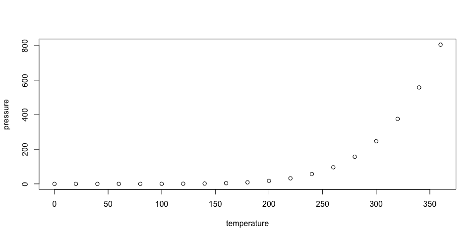

p8105_hw3_ym3197
================
Yichaun Ma
2026-10-19

\#problem 1

\#Set global figure dimensions, font size, and code chunk options.

``` r
knitr::opts_chunk$set(
  echo = TRUE,
  message = FALSE,
  fig.width = 10,
  fig.height = 5
)

library(tidyverse)
```

    ## ── Attaching core tidyverse packages ──────────────────────── tidyverse 2.0.0 ──
    ## ✔ dplyr     1.2.1     ✔ readr     2.2.0
    ## ✔ forcats   1.0.1     ✔ stringr   1.6.0
    ## ✔ ggplot2   4.0.3     ✔ tibble    3.3.1
    ## ✔ lubridate 1.9.5     ✔ tidyr     1.3.2
    ## ✔ purrr     1.2.2     
    ## ── Conflicts ────────────────────────────────────────── tidyverse_conflicts() ──
    ## ✖ dplyr::filter() masks stats::filter()
    ## ✖ dplyr::lag()    masks stats::lag()
    ## ℹ Use the conflicted package (<http://conflicted.r-lib.org/>) to force all conflicts to become errors

``` r
library(p8105.datasets)
library(patchwork)

theme_set(
  theme_minimal(base_size = 12)
)
```

# Load ny_noaa

``` r
data("ny_noaa")
```

``` r
glimpse(ny_noaa)
```

    ## Rows: 2,595,176
    ## Columns: 7
    ## $ id   <chr> "US1NYAB0001", "US1NYAB0001", "US1NYAB0001", "US1NYAB0001", "US1N…
    ## $ date <date> 2007-11-01, 2007-11-02, 2007-11-03, 2007-11-04, 2007-11-05, 2007…
    ## $ prcp <int> NA, NA, NA, NA, NA, NA, NA, NA, NA, NA, NA, NA, NA, NA, NA, NA, 3…
    ## $ snow <int> NA, NA, NA, NA, NA, NA, NA, NA, NA, NA, NA, NA, NA, NA, NA, NA, 3…
    ## $ snwd <int> NA, NA, NA, NA, NA, NA, NA, NA, NA, NA, NA, NA, NA, NA, NA, NA, 0…
    ## $ tmax <chr> NA, NA, NA, NA, NA, NA, NA, NA, NA, NA, NA, NA, NA, NA, NA, NA, N…
    ## $ tmin <chr> NA, NA, NA, NA, NA, NA, NA, NA, NA, NA, NA, NA, NA, NA, NA, NA, N…

``` r
noaa_summary =
  ny_noaa |>
  summarize(
    n_observations = n(),
    n_variables = ncol(ny_noaa),
    n_stations = n_distinct(id),
    first_date = min(date, na.rm = TRUE),
    last_date = max(date, na.rm = TRUE)
  )

noaa_summary
```

    ## # A tibble: 1 × 5
    ##   n_observations n_variables n_stations first_date last_date 
    ##            <int>       <int>      <int> <date>     <date>    
    ## 1        2595176           7        747 1981-01-01 2010-12-31

``` r
missing_summary =
  ny_noaa |>
  summarize(
    across(
      c(prcp, snow, snwd, tmax, tmin),
      list(
        n_missing = ~sum(is.na(.x)),
        pct_missing = ~mean(is.na(.x)) * 100
      ),
      .names = "{.col}_{.fn}"
    )
  ) |>
  pivot_longer(
    cols = everything(),
    names_to = c("variable", ".value"),
    names_pattern = "^(.*)_(n_missing|pct_missing)$"
  ) |>
  mutate(
    pct_missing = round(pct_missing, 2)
  )

knitr::kable(
  missing_summary,
  col.names = c(
    "Variable",
    "Missing observations",
    "Missing (%)"
  )
)
```

| Variable | Missing observations | Missing (%) |
|:---------|---------------------:|------------:|
| prcp     |               145838 |        5.62 |
| snow     |               381221 |       14.69 |
| snwd     |               591786 |       22.80 |
| tmax     |              1134358 |       43.71 |
| tmin     |              1134420 |       43.71 |

# data cleanning

``` r
noaa_clean =
  ny_noaa |>
  separate(
    date,
    into = c("year", "month", "day"),
    sep = "-",
    convert = TRUE
  ) |>
  mutate(
    tmax = as.numeric(tmax) / 10,
    tmin = as.numeric(tmin) / 10,
    prcp = prcp / 10
  )
```

# Exclude missing snowfall values, sort snowfall amounts by frequency, and display the 10 most common values.

``` r
snow_counts =
  noaa_clean |>
  filter(!is.na(snow)) |>
  count(snow, sort = TRUE)

knitr::kable(
  snow_counts |>
    slice_head(n = 10),
  col.names = c("Snowfall (mm)", "Number of observations")
)
```

| Snowfall (mm) | Number of observations |
|--------------:|-----------------------:|
|             0 |                2008508 |
|            25 |                  31022 |
|            13 |                  23095 |
|            51 |                  18274 |
|            76 |                  10173 |
|             8 |                   9962 |
|             5 |                   9748 |
|            38 |                   9197 |
|             3 |                   8790 |
|           102 |                   6552 |

# Use records with nonmissing snowfall as the denominator.

``` r
snow_summary =
  noaa_clean |>
  summarize(
    n_observed = sum(!is.na(snow)),
    n_zero = sum(snow == 0, na.rm = TRUE),
    pct_zero = mean(snow == 0, na.rm = TRUE) * 100
  )

snow_summary
```

    ## # A tibble: 1 × 3
    ##   n_observed  n_zero pct_zero
    ##        <int>   <int>    <dbl>
    ## 1    2213955 2008508     90.7

# Average maximum temperature in January and July

``` r
monthly_tmax =
  noaa_clean |>
  filter(month %in% c(1, 7)) |>
  group_by(id, year, month) |>
  summarize(
    n_days = sum(!is.na(tmax)),
    mean_tmax = mean(tmax, na.rm = TRUE),
    .groups = "drop"
  ) |>
  filter(n_days > 0) |>
  mutate(
    month = factor(
      month,
      levels = c(1, 7),
      labels = c("January", "July")
    )
  )
```

# Each point represents a station’s average maximum temperature in January or July of a particular year. Both panels use the same y-axis scale for comparison.

``` r
monthly_tmax_plot =
  monthly_tmax |>
  ggplot(aes(x = year, y = mean_tmax)) +
  geom_point(
    alpha = 0.15,
    size = 0.6
  ) +
  facet_wrap(~month, nrow = 1) +
  labs(
    title = "Average maximum temperature in January and July",
    x = "Year",
    y = "Monthly average maximum temperature (°C)"
  )

monthly_tmax_plot
```

<!-- -->

# List the five lowest monthly averages for January and July separately, together with station IDs, years, observation counts.

``` r
lowest_tmax =
  monthly_tmax |>
  group_by(month) |>
  slice_min(
    order_by = mean_tmax,
    n = 5,
    with_ties = FALSE
  ) |>
  ungroup()

knitr::kable(lowest_tmax, digits = 2)
```

| id          | year | month   | n_days | mean_tmax |
|:------------|-----:|:--------|-------:|----------:|
| USC00301723 | 1982 | January |     31 |    -13.44 |
| USC00305925 | 2005 | January |      1 |    -12.20 |
| USC00306957 | 2004 | January |     31 |    -10.79 |
| USC00304996 | 1994 | January |     31 |    -10.62 |
| USW00094725 | 2004 | January |     31 |    -10.41 |
| USC00308962 | 1988 | July    |     31 |     13.95 |
| USC00302454 | 2004 | July    |     31 |     18.30 |
| USC00308946 | 1984 | July    |     31 |     19.08 |
| USC00309389 | 2007 | July    |     31 |     19.22 |
| USC00306957 | 2000 | July    |     31 |     19.76 |

# List the five highest monthly averages for January and July separately. Interpret extreme averages alongside their observation counts.

``` r
highest_tmax =
  monthly_tmax |>
  group_by(month) |>
  slice_max(
    order_by = mean_tmax,
    n = 5,
    with_ties = FALSE
  ) |>
  ungroup()

knitr::kable(highest_tmax, digits = 2)
```

| id          | year | month   | n_days | mean_tmax |
|:------------|-----:|:--------|-------:|----------:|
| USC00303464 | 1998 | January |     13 |     10.22 |
| USR0000NSTO | 2004 | January |      2 |      9.75 |
| USC00307633 | 1999 | January |     21 |      9.49 |
| USC00307633 | 2002 | January |     30 |      9.24 |
| USW00014732 | 2006 | January |     31 |      9.14 |
| USC00305377 | 2010 | July    |     31 |     33.60 |
| USC00309292 | 1999 | July    |     31 |     32.77 |
| USC00308946 | 2010 | July    |     31 |     32.66 |
| USW00014732 | 2010 | July    |     31 |     32.57 |
| USC00304025 | 1999 | July    |     17 |     32.52 |

# include all months and retain records with both maximum and minimum temperatures observed.

``` r
temp_data =
  noaa_clean |>
  filter(
    !is.na(tmin),
    !is.na(tmax)
  )
```

# Use a two-dimensional binned plot to address overplotting. The dashed line represents equal maximum and minimum temperatures. Records below it have maximum temperatures lower than minimum temperatures and warrant investigation.

``` r
temp_plot =
  temp_data |>
  ggplot(aes(x = tmin, y = tmax)) +
  geom_bin2d(bins = 80) +
  geom_abline(
    intercept = 0,
    slope = 1,
    linetype = "dashed"
  ) +
  scale_fill_viridis_c(trans = "log10") +
  labs(
    title = "Maximum vs minimum temperature",
    x = "Daily minimum temperature (°C)",
    y = "Daily maximum temperature (°C)",
    fill = "Count"
  )
```

# Calculate the correlation between observed temperatures and count records where maximum temperature is below minimum temperature to support interpretation.

``` r
temp_summary =
  temp_data |>
  summarize(
    n_pairs = n(),
    correlation = cor(tmin, tmax),
    n_tmax_below_tmin = sum(tmax < tmin)
  )

temp_summary
```

    ## # A tibble: 1 × 3
    ##   n_pairs correlation n_tmax_below_tmin
    ##     <int>       <dbl>             <int>
    ## 1 1458900       0.905              1183

``` r
snow_data =
  noaa_clean |>
  filter(
    snow > 0,
    snow < 100
  )
```

# Create one boxplot per year to compare the medians, interquartile ranges, and distributions of the selected snowfall amounts.

``` r
snow_plot =
  snow_data |>
  ggplot(aes(x = snow, y = factor(year))) +
  geom_boxplot(outlier.size = 0.4) +
  labs(
    title = "Snowfall distribution by year",
    x = "Year",
    y = "Daily snowfall (mm)"
  ) +
  theme(
    axis.text.x = element_text(
      angle = 90,
      hjust = 1,
      vjust = 0.5,
      size = 8
    )
  )
```

# Display the plots side by side, giving the snowfall panel more width to improve the readability of year labels.

``` r
temp_snow_plot =
  temp_plot + snow_plot +
  plot_layout(widths = c(1, 1.5))

temp_snow_plot
```

<!-- -->

# Calculate yearly observation counts, medians, and quartiles to support interpretation of the boxplots.

``` r
snow_year_summary =
  snow_data |>
  group_by(year) |>
  summarize(
    n_records = n(),
    median_snow = median(snow),
    q1_snow = quantile(snow, 0.25),
    q3_snow = quantile(snow, 0.75),
    .groups = "drop"
  )

knitr::kable(snow_year_summary, digits = 2)
```

| year | n_records | median_snow | q1_snow | q3_snow |
|-----:|----------:|------------:|--------:|--------:|
| 1981 |      5961 |          25 |      13 |      51 |
| 1982 |      5991 |          25 |      13 |      51 |
| 1983 |      4785 |          25 |      13 |      51 |
| 1984 |      5373 |          25 |      13 |      51 |
| 1985 |      6887 |          25 |      13 |      51 |
| 1986 |      5400 |          25 |      13 |      51 |
| 1987 |      4780 |          25 |      13 |      51 |
| 1988 |      5077 |          25 |      13 |      51 |
| 1989 |      6086 |          25 |      13 |      51 |
| 1990 |      4570 |          25 |      13 |      51 |
| 1991 |      5149 |          25 |      13 |      51 |
| 1992 |      5488 |          25 |      13 |      51 |
| 1993 |      5494 |          25 |      13 |      51 |
| 1994 |      5277 |          25 |      13 |      51 |
| 1995 |      5659 |          25 |      13 |      51 |
| 1996 |      5687 |          25 |      13 |      51 |
| 1997 |      5639 |          25 |      13 |      51 |
| 1998 |      3071 |          25 |      13 |      46 |
| 1999 |      3917 |          25 |      13 |      51 |
| 2000 |      4794 |          25 |      13 |      51 |
| 2001 |      4461 |          25 |      13 |      51 |
| 2002 |      4977 |          25 |      13 |      51 |
| 2003 |      5098 |          25 |      13 |      51 |
| 2004 |      5612 |          25 |      13 |      48 |
| 2005 |      6203 |          25 |      13 |      51 |
| 2006 |      4604 |          25 |      10 |      38 |
| 2007 |      6946 |          25 |      13 |      48 |
| 2008 |      9260 |          25 |      13 |      51 |
| 2009 |      8735 |          25 |      10 |      51 |
| 2010 |     11590 |          25 |      10 |      43 |

## R Markdown

This is an R Markdown document. Markdown is a simple formatting syntax
for authoring HTML, PDF, and MS Word documents. For more details on
using R Markdown see <http://rmarkdown.rstudio.com>.

When you click the **Knit** button a document will be generated that
includes both content as well as the output of any embedded R code
chunks within the document. You can embed an R code chunk like this:

``` r
summary(cars)
```

    ##      speed           dist       
    ##  Min.   : 4.0   Min.   :  2.00  
    ##  1st Qu.:12.0   1st Qu.: 26.00  
    ##  Median :15.0   Median : 36.00  
    ##  Mean   :15.4   Mean   : 42.98  
    ##  3rd Qu.:19.0   3rd Qu.: 56.00  
    ##  Max.   :25.0   Max.   :120.00

## Including Plots

You can also embed plots, for example:

<!-- -->

Note that the `echo = FALSE` parameter was added to the code chunk to
prevent printing of the R code that generated the plot.
